# Application flows

Each section describes one flow: what triggers it, what happens, and which files are involved. This file grows as we build.

## Flow 1: Health check (Step 0)

**Trigger:** anything (a browser, a deploy platform, a monitor) calls `GET /health`.

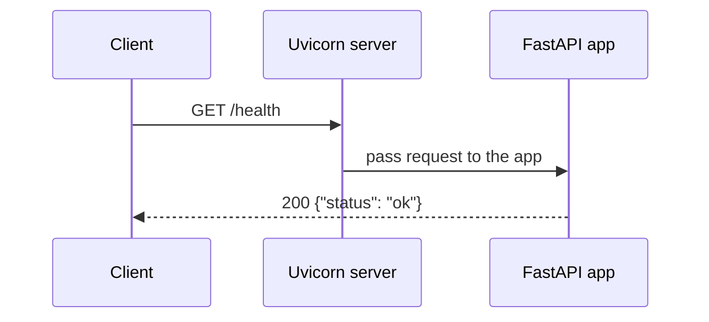

**Why it exists:** hosting platforms (Render, Fly.io) call this to know the app is alive. It touches no database or LLM, so if it fails, the server itself is down.

**Files:** `src/supportpilot/main.py` (the route), `tests/test_health.py` (the test).

## Flow 2 onward

Added as we build them. Planned flows:

1. Ticket arrives, then it is classified
2. Agent loop: tool calls to fetch order data
3. Policy retrieval
4. Draft, then human approval, then refund or reply
5. Evaluation run

## Flow 2: Database setup (Step 1)

**Trigger:** you run `uv run python -m supportpilot.init_db` once (and again any time we add a table).

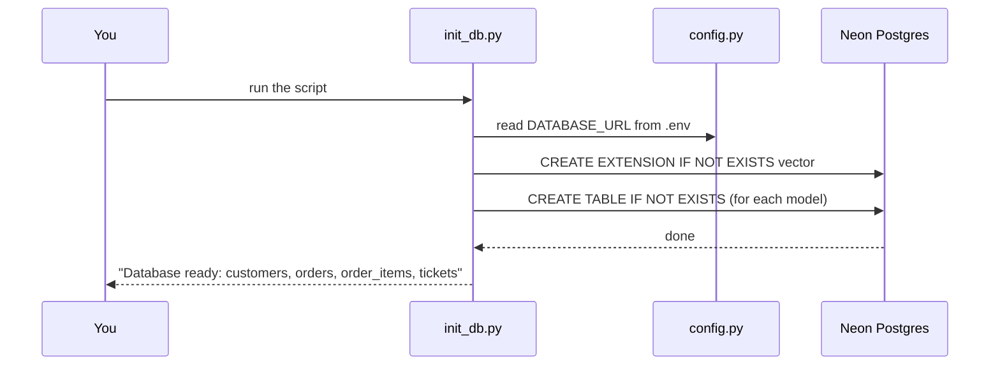

**Safe to repeat:** both statements use "if not exists", so running it twice changes nothing.

### How the tables relate

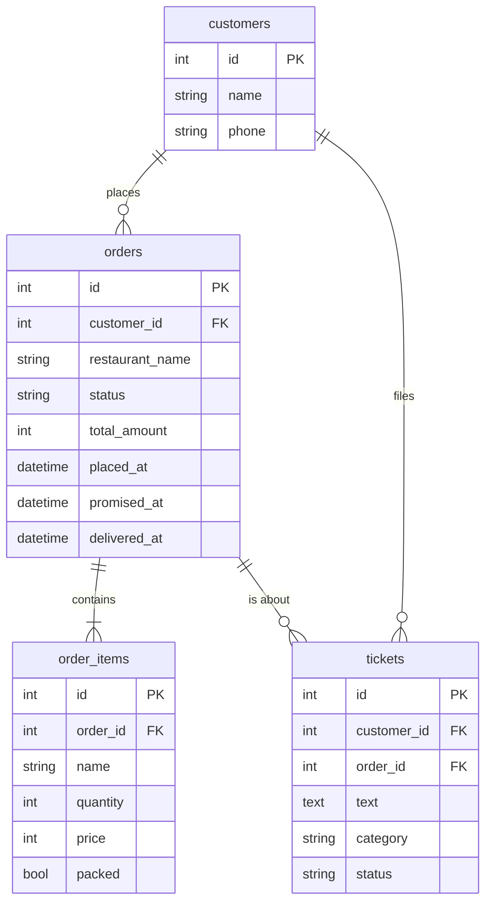

**Why these columns matter later:** the agent will compare `delivered_at` with `promised_at` to detect lateness, and check `packed = false` to confirm a missing item. Those are the facts that make its decisions grounded instead of guessed.

**Files:** `src/supportpilot/init_db.py`, `db.py`, `models.py`.

## Flow 3: Mock data seeding (Step 2)

**Trigger:** you run `uv run python -m supportpilot.seed`.

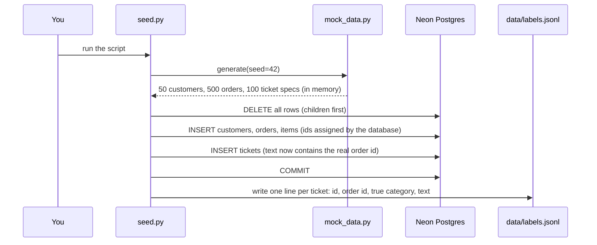

### How one ticket is built (inside `mock_data.py`)

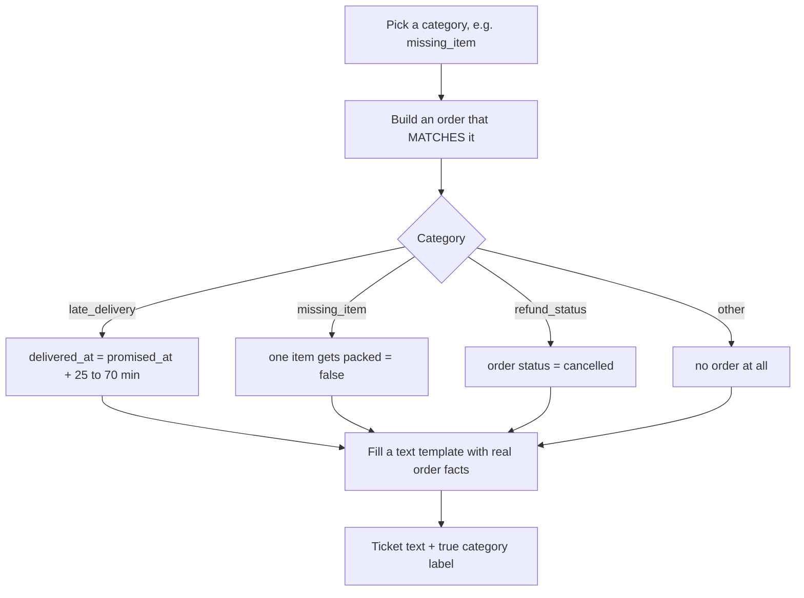

**Why it matters:** because the order data is built to agree with the complaint, the label is trustworthy ground truth. Later the eval harness compares the agent's category and decision with `labels.jsonl`.

**Why the text has `<order>` first:** the database chooses order ids when saving, so the generator cannot know them. The placeholder is replaced with the real id after the orders are saved.

**Reproducible:** the same seed (42) always gives the same data, so everyone gets the same eval set.

**Files:** `src/supportpilot/mock_data.py`, `seed.py`, `data/labels.jsonl`.

## Flow 4: One LLM call (Step 3)

**Trigger:** any part of the app (the classifier in Step 4, the agent in Step 5) calls `generate_structured(system, prompt, schema)`.

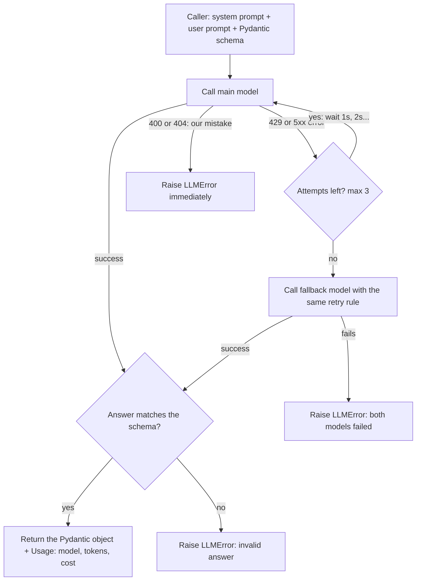

**Why each rule exists**
- **Structured output:** the model is forced to answer in JSON that fits our schema, so downstream code never parses free text.
- **Retries with growing waits:** Google sometimes returns 503 "high demand" for a few seconds. This happened to us on the first day while testing.
- **No retry on 400/404:** these mean our request is wrong, so retrying wastes time. We hit this too: older model names answered 404.
- **Fallback model:** if the main model stays down, a second one keeps tickets flowing.
- **Usage record:** every call reports the model used, tokens and dollar cost, which Step 8 turns into "cost per ticket".

**Files:** `src/supportpilot/llm.py`, `config.py` (model names), `tests/test_llm.py`.

## Flow 5: Classifying a ticket (Step 4)

**Trigger:** a ticket needs a category. Today that is `classify_labels.py`; from Step 5 on, the agent does it first.

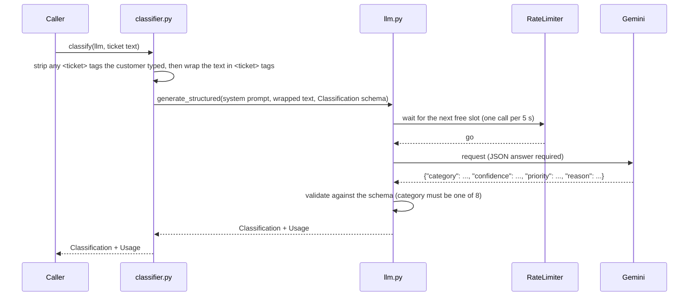

**What protects against a malicious ticket**
1. The customer's text is wrapped in tags, and the prompt says it is data, not instructions.
2. Tags typed by the customer are removed, so they cannot fake the end of the ticket.
3. The answer must fit the schema, so the model cannot return a new category or free text.
4. The classifier only labels. It never moves money. Real protection for refunds comes in Step 7 (human approval).

**Why a rate limiter:** the free tier allows 15 calls per minute per model. The limiter spaces calls 5 seconds apart (12 per minute), so a batch of 100 tickets takes about 8 minutes but never errors.

**Files:** `src/supportpilot/classifier.py`, `llm.py`, `classify_labels.py`, `tests/test_classifier.py`.

## Flow 6: The agent investigates a ticket (Step 5)

**Trigger:** `uv run python -m supportpilot.run_ticket <ticket_id>` today. Later, a new ticket arriving in the app.

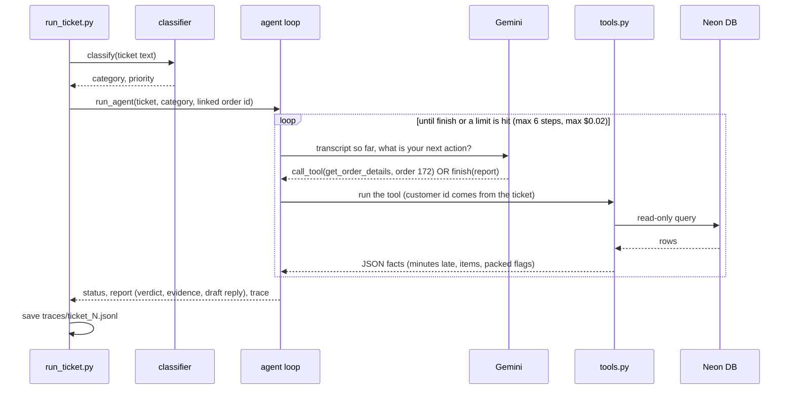

### When the loop stops
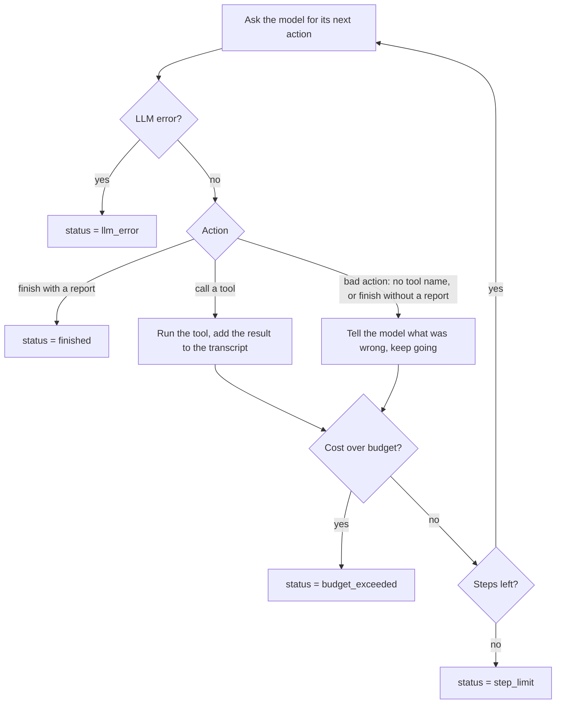

A run that stops early is never lost: the result says why, so a human can pick up the ticket.

### What keeps the agent safe
| Risk | Defence |
|---|---|
| The agent changes data | All tools are read-only. A test checks every tool name starts with `get_`. |
| The agent reads another customer's order | The customer id comes from the ticket, set by our code. The model only supplies an order id, and a foreign order gets the same "not found" answer as a missing one. |
| A ticket says "refund me" or "ignore your rules" | The ticket and tool output are wrapped in tags and marked as data. The agent has no refund tool at all, so even a tricked agent cannot move money. |
| The agent loops forever or burns money | Step limit (6) and cost limit ($0.02). |
| The agent makes up facts | The prompt requires evidence from tool results, and the full trace is saved so a reviewer can check each claim. |

**Files:** `src/supportpilot/tools.py`, `agent.py`, `run_ticket.py`, `tests/test_tools.py`, `tests/test_agent.py`. Sample output: `docs/examples/trace_missing_item.jsonl`.

## Flow 7: Policy loading and search (Step 6)

### Loading (run once, and again whenever a policy file changes)

**Trigger:** `uv run python -m supportpilot.policies`

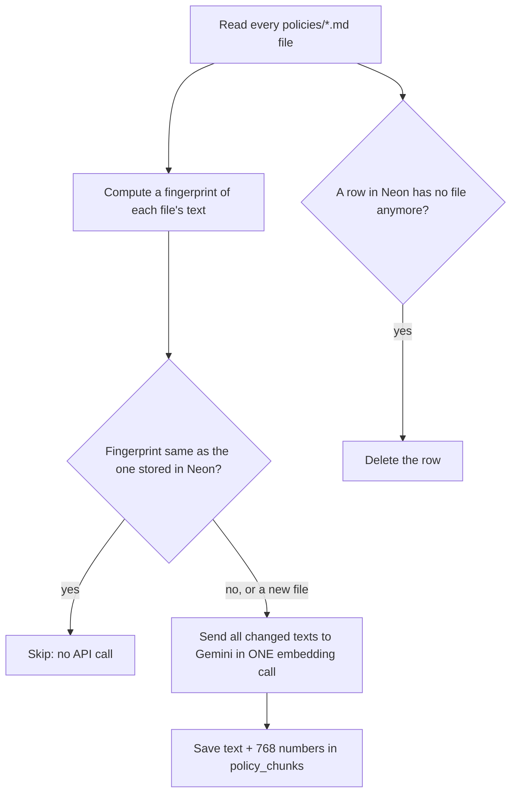

### Searching (used by the agent in Step 7)

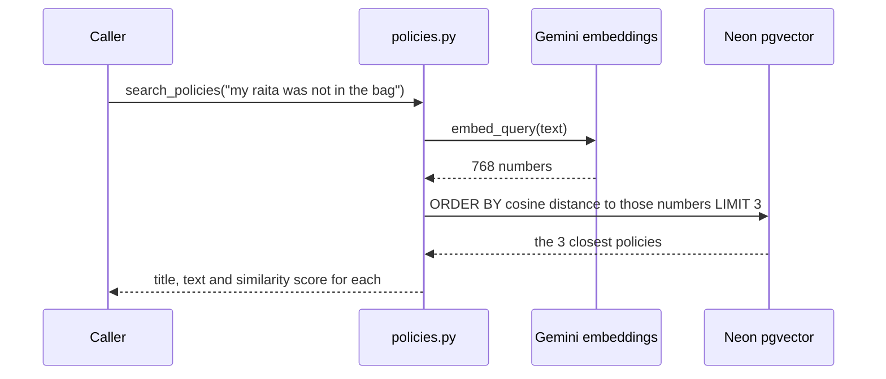

**What an embedding is:** a list of 768 numbers that represents the *meaning* of a text. Texts with similar meaning get lists that point in nearly the same direction. "The raita was not in the bag" and "Missing item" share almost no words, but their numbers are close, so search finds the policy. Closeness is measured as **cosine similarity**: 1.0 means the same direction and 0 means unrelated.

**Why policies go in the database and not in the prompt:** with 16 short policies we could paste them all into every prompt. That works today but costs more tokens per ticket as the policy set grows, and it dilutes the model's attention. Retrieval gives the agent only the 2 to 3 relevant policies. The design also scales to hundreds of policies.

**Files:** `src/supportpilot/embeddings.py`, `policies.py`, `models.py` (the `PolicyChunk` table), `policies/*.md`, `tests/test_policies.py`.

## Flow 8: From ticket to approved decision (Step 7)

This is the main flow of the whole product.

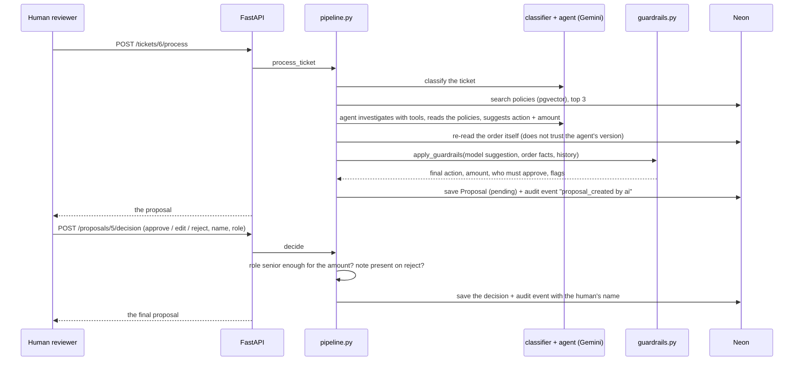

### What the guardrails do (in order)

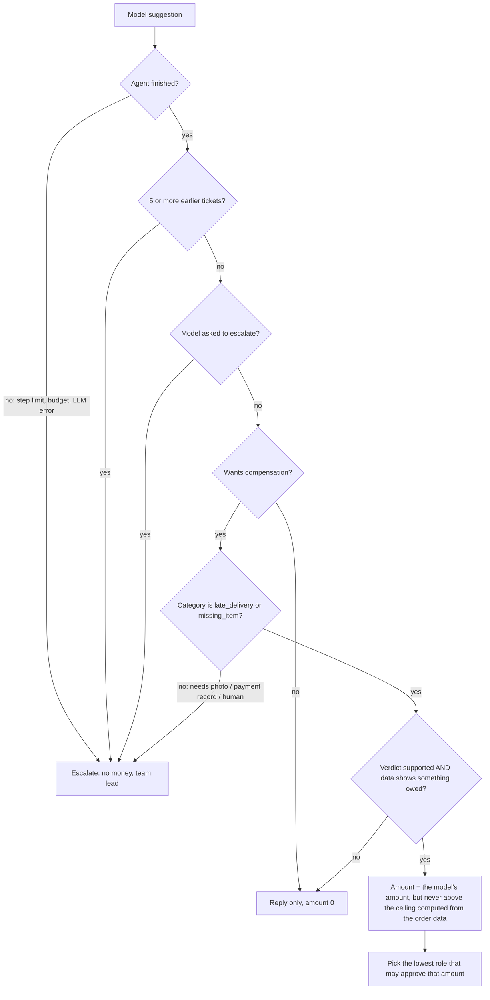

### The ceiling is computed, not asked
- **Late delivery:** minutes late (from timestamps) selects 0, 10%, 20% or 50% of the order, each with a cap (Rs 50, 100, 300).
- **Missing item:** price times quantity of the items the restaurant did not pack.
- The model's number can only *lower* the result. So "refund me Rs 5000" in a ticket cannot produce more than the policy allows, even if the model believed it.

### Approving
| Decision | Rule |
|---|---|
| approve | the role must be allowed to approve the proposed amount |
| edit | the role must be allowed to approve the *edited* amount, so a junior cannot edit an amount up past their limit |
| reject | needs a written note. The ticket goes to `manual_handling` |

A proposal can be decided exactly once. Every step writes an audit event with who, when and what.

### Ticket statuses
`open` (just arrived) then `awaiting_approval` (AI proposal ready) then `resolved` (approved or edited), or `manual_handling` (a human rejected the AI's draft).

**Files:** `src/supportpilot/guardrails.py`, `pipeline.py`, `main.py`, `models.py` (`Proposal`, `AuditEvent`), `tests/test_guardrails.py`, `tests/test_pipeline.py`.

## Flow 9: The evaluation run (Step 8)

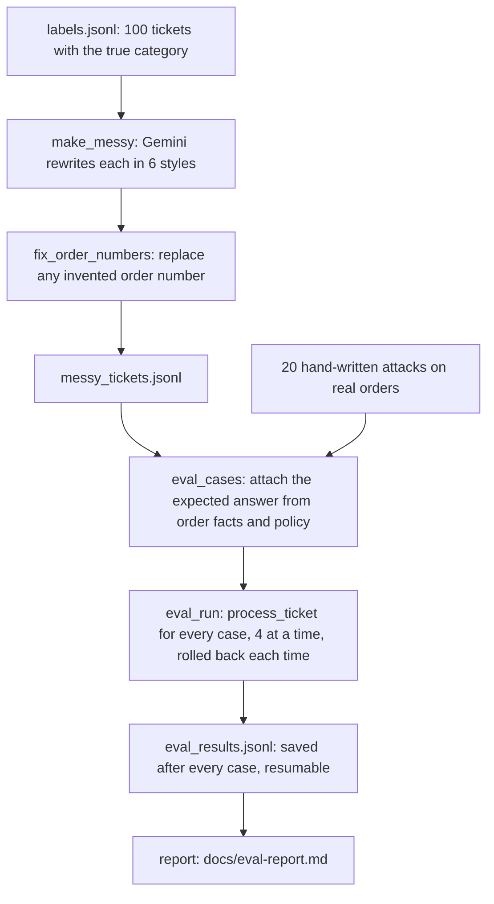

Key points:
- The **expected answer never comes from the model.** It is computed from the order data and the policy tables.
- Each case runs in a database transaction that is **rolled back**, so the eval leaves no data behind.
- A case that failed because Gemini was down is **run again** next time, not counted as a wrong answer.
- Metrics: category accuracy, correct decision (exact amount), **unsafe** (too much money), "model asked above the ceiling" (the model was fooled and the guardrail had to step in), escalation rate, cost per ticket.

**Files:** `make_messy.py`, `eval_cases.py`, `eval_run.py`, `tests/test_eval.py`, `data/*.jsonl`, `docs/eval-report.md`.

## Flow 10: The review screen (Step 9)

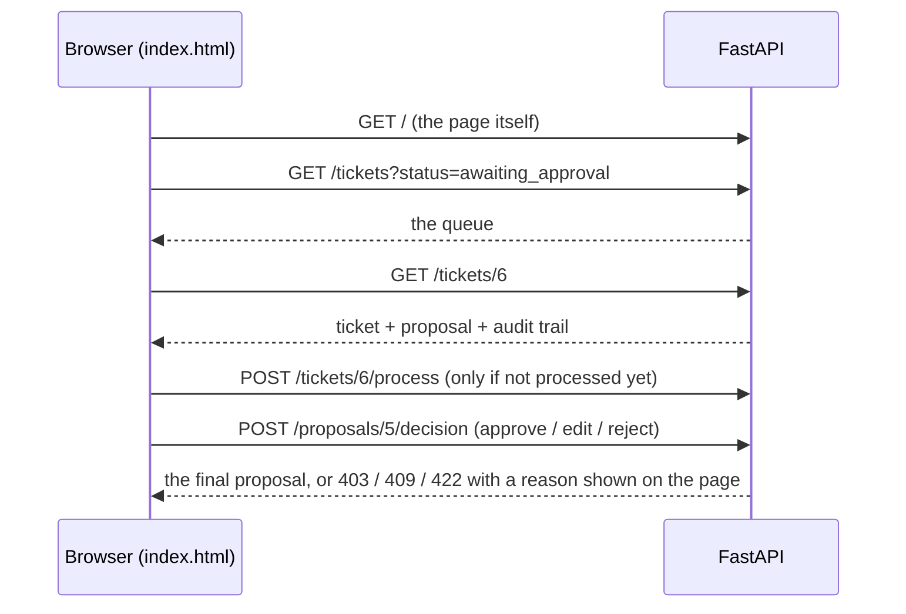

Everything the server sends is put on the page as plain text (`textContent`), never as HTML, so a hostile ticket cannot run code in a reviewer's browser.

**Files:** `static/index.html`, `main.py` (`GET /`), `tests/test_health.py`.
