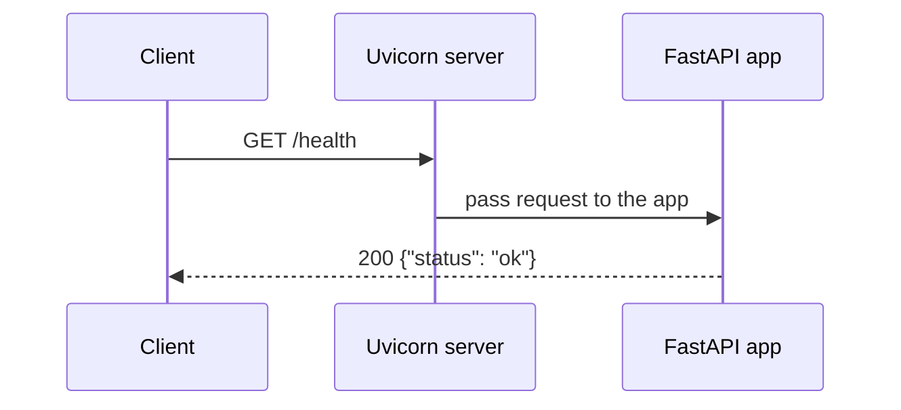
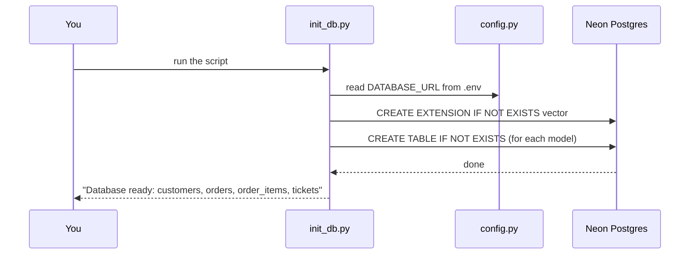
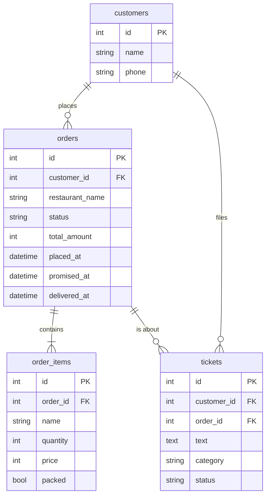

# Application flows

Each section describes one flow: what triggers it, what happens, and which files are involved. This file grows as we build.

## Flow 1: Health check (Step 0)

**Trigger:** anything (a browser, a deploy platform, a monitor) calls `GET /health`.

**Why it exists:** hosting platforms (Render, Fly.io) call this to know the app is alive. It touches no database or LLM, so if it fails, the server itself is down.

**Files:** `src/supportpilot/main.py` (the route), `tests/test_health.py` (the test).

## Flow 2 onward

Added as we build them. Planned flows:

1. Ticket arrives, then it is classified
2. Agent loop: tool calls to fetch order data
3. Policy retrieval
4. Draft, then human approval, then refund or reply
5. Evaluation run

## Flow 2: Database setup (Step 1)

**Trigger:** you run `uv run python -m supportpilot.init_db` once (and again any time we add a table).

**Safe to repeat:** both statements use "if not exists", so running it twice changes nothing.

### How the tables relate

**Why these columns matter later:** the agent will compare `delivered_at` with `promised_at` to detect lateness, and check `packed = false` to confirm a missing item. Those are the facts that make its decisions grounded instead of guessed.

**Files:** `src/supportpilot/init_db.py`, `db.py`, `models.py`.
